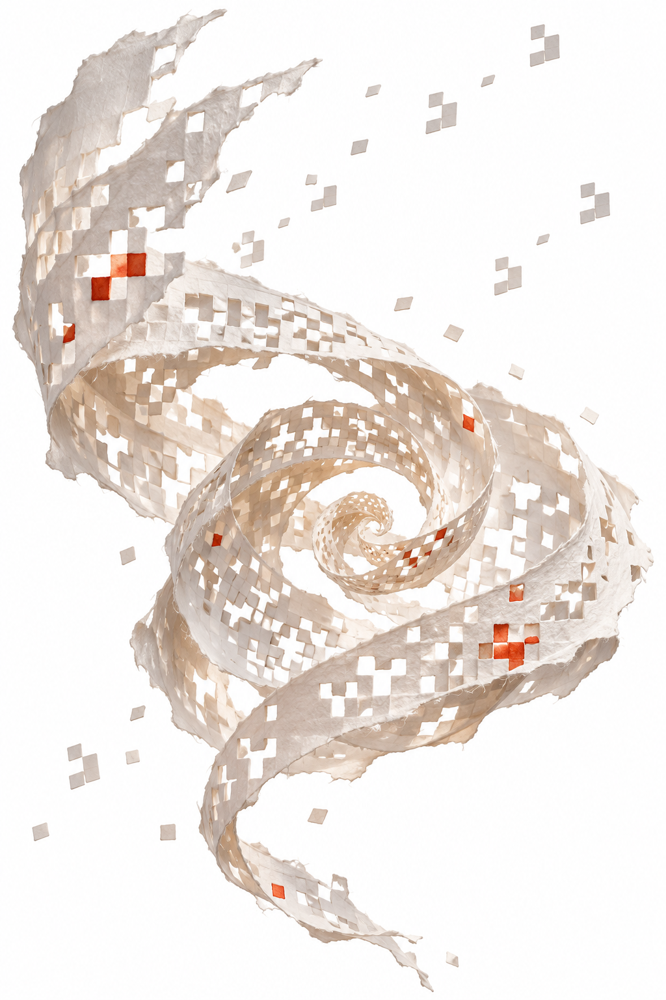

# jaGOF

<p align="center">
  
</p>

**Just another Conway's Game of Life**, written in Python with Pygame.

Draw live cells, advance one generation at a time, or watch a seed pattern evolve.
The board wraps around both edges: cells on opposite sides are neighbours.

Originally released as **jaGof 0.1.0** on **14 February 2011** by [Luca Amore](https://www.lucaamore.com/).

## Requirements

- **Python 2**, with the `python2` interpreter available.
- **Pygame built for that Python 2 interpreter**.
- A graphical desktop environment.

This is a legacy Python 2 application. It uses Python 2 syntax, `ConfigParser`,
and integer division; it does **not** run unchanged on Python 3. Installing
Pygame for Python 3 alone will not satisfy its dependencies.

## Getting started

Clone the repository and enter its root directory:

```sh
git clone https://github.com/lookee/jaGOF.git
cd jaGOF
```

Check that Pygame is available to your Python 2 interpreter:

```sh
python2 -c "import pygame; print(pygame.version.ver)"
```

If the import fails, install a Python 2-compatible Pygame build in the same
environment before continuing. This repository does not include an installer
or a dependency lock file.

Start with an empty board:

```sh
python2 src/jaGof.py
```

Or load one of the bundled seed patterns:

```sh
python2 src/jaGof.py seeds/glider.cells
python2 src/jaGof.py seeds/Gosper_glider_gun.cells
```

The simulation starts paused. Press **M** to animate, or **E** to advance a
single generation.

Run these commands from the repository root: the application reads
`jaGof.conf` from the current working directory. The root-level `jaGof`
launcher is a symbolic link to `src/jaGof.py`; `./jaGof` also works when
`python` resolves to Python 2.

## Controls

| Input | Action |
| --- | --- |
| Left mouse click | Make a cell alive |
| Right mouse click | Make a cell dead |
| **E** | Advance one generation and pause continuous evolution |
| **M** | Toggle continuous evolution |
| **+** | Speed up evolution by reducing the delay |
| **-** | Slow down evolution by increasing the delay |
| **Q** or **Esc** | Quit |
| Close the window | Quit |

When quitting, the application prints the number of generations computed.

## Configuration

Edit [`jaGof.conf`](jaGof.conf) before starting the application.
The bundled defaults are:

```ini
[life]
sizex=80
sizey=50

[screen]
width=800
heigth=500

[animation]
waitTime_ms=100
waitTimeMin_ms=10
waitTimeMax_ms=1000
waitTimeStep_ms=25
```

| Setting | Meaning |
| --- | --- |
| `life.sizex`, `life.sizey` | Board width and height in cells |
| `screen.width`, `screen.heigth` | Window width and height in pixels |
| `animation.waitTime_ms` | Initial delay between generations, in milliseconds |
| `animation.waitTimeMin_ms` | Minimum delay when speeding up |
| `animation.waitTimeMax_ms` | Maximum delay when slowing down |
| `animation.waitTimeStep_ms` | Delay adjustment for each **+** or **-** keypress |

Keep the spelling **`heigth`**: it is the key expected by the code.
Use positive board dimensions and a window large enough to display the cells.
Larger patterns may require increasing `sizex` and `sizey`.

## Seed patterns

The [`seeds/`](seeds) directory contains **447 patterns** in plain-text
`.cells` format, including gliders, oscillators, spaceships, and glider guns.
An additional breeder pattern is available in [`other/`](other).

The loader reads:

- Lines starting with `!` as comments.
- Uppercase `O` as a live cell.
- `.` as a dead cell.

For example, a glider can be represented as:

```text
!Name: glider
OOO
O..
.O.
```

Save the text as `glider.cells`, then pass its path as the first argument:

```sh
python2 src/jaGof.py glider.cells
```

Use rows of equal width and leave spare room around the pattern in the board.
The legacy loader counts line endings toward the row width and has limited
size validation, so oversized or irregular patterns may fail to load correctly.

The original README credits the
[Game of Life Lexicon](https://www.bitstorm.org/gameoflife/lexicon/) and the
[pylife project](https://github.com/durden/pylife) for the bundled seed collection.

## How Life works

Each cell has eight neighbours. At every generation:

- A live cell survives with two or three live neighbours.
- A dead cell becomes alive with exactly three live neighbours.
- All other cells become, or remain, dead.

All cells update together. In this implementation, the board is finite and
wraps horizontally and vertically.

## Project layout

```text
jaGof                 Symbolic link to the entry point
jaGof.conf            Board, window, and animation settings
src/jaGof.py          Application entry point
src/Grid/            Grid model, Pygame view, and input handling
src/Life/            Game of Life rules and simulation controls
seeds/               Bundled .cells seed patterns
other/               Additional pattern
COPYING               GNU GPL license text
```

## Resources

- [Project article](https://www.lucaamore.com/john-conways-game-of-life-in-python/)
- [LifeWiki](https://conwaylife.com/wiki/)
- [Conway's Game of Life on Wikipedia](https://en.wikipedia.org/wiki/Conway%27s_Game_of_Life)

## License

Copyright © 2011 Luca Amore.

jaGof is free software licensed under the **GNU General Public License,
version 3 or later**. It is distributed without any warranty.
See [COPYING](COPYING) for the full license.
